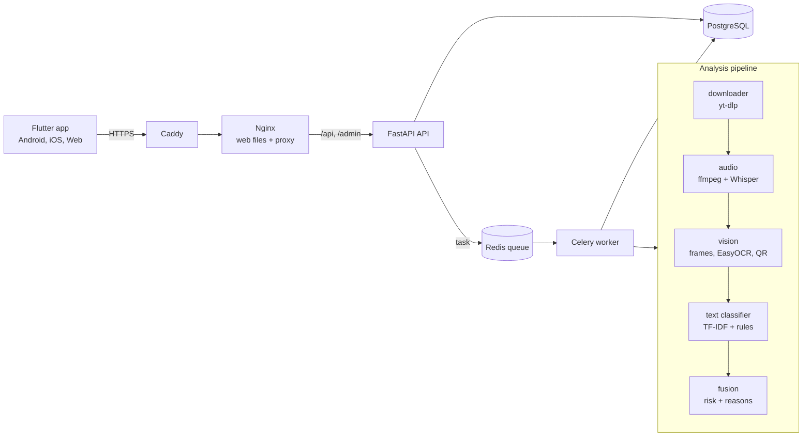

# Architecture

## One analysis, step by step

1. The app sends `POST /api/v1/analyze` with a link or a file.
2. The API checks the input (TikTok host only, size, type, duration),
   saves a `videos` row and an `analyses` row with status `queued`,
   puts a task in Redis and answers at once with `analysis_id`.
3. The worker takes the task. It sets `running` and moves through the
   stages `downloading` → `listening` → `reading_screen` → `scoring`.
4. The pipeline downloads the video, transcribes speech, samples frames,
   reads text with OCR, finds QR codes, then classifies the text and fuses
   all signals into one score.
5. The worker saves the result, the reasons and the signals, sets `done`
   (or `failed` with an `error_code`) and deletes the video file.
6. The app polls `GET /api/v1/analyses/{id}` every 2 seconds and shows each
   stage, then the result.

## Main files

| File | Job |
|---|---|
| `backend/app/main.py` | creates the app, middleware, routers, admin |
| `backend/app/settings/` | settings: `base.py`, `env/local.py`, `env/prod.py`, `conf.py` picks one |
| `backend/app/workers/tasks.py` | analysis task, cleanup task, heartbeat |
| `backend/app/services/pipeline.py` | runs the steps in order and handles errors |
| `frontend/lib/state/providers.dart` | app state with Riverpod |
| `frontend/lib/data/api/` | dio client with token refresh |

## Why these choices

- The analysis runs in a worker, so a slow video never blocks the API.
- Polling is simpler than WebSockets and works through every proxy.
- Models are small and run on a CPU, so one cheap VPS is enough.
