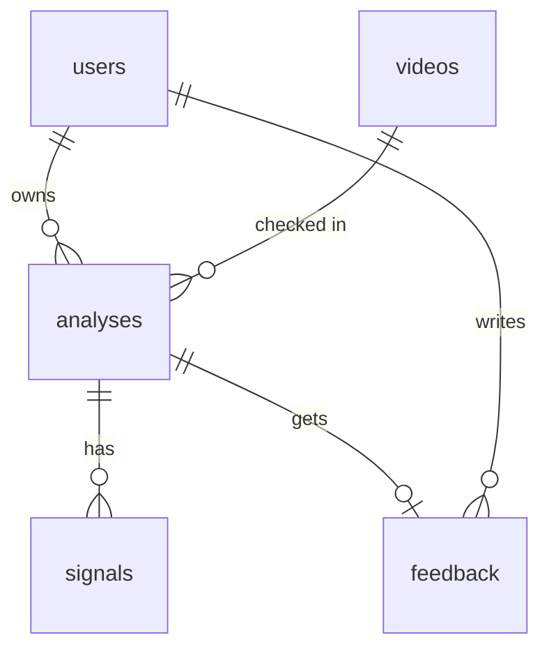

# Database

PostgreSQL 16 in Docker and production. Tests use SQLite. Tables are created
only by Alembic migrations (`backend/alembic/versions/`).



| Table | Main columns | Notes |
|---|---|---|
| `users` | id, email (unique), password_hash (argon2), is_admin, is_active | |
| `videos` | id, source_type, source_url, original_filename, sha256, size_bytes, duration_seconds, stored_path, file_deleted_at | the file itself is deleted after analysis |
| `analyses` | id (uuid), user_id → users, client_id, video_id → videos, status, stage, risk_score, category, reasons (JSON), transcript, ocr_text, links, phones, qr_codes, error_code, processing_seconds, timestamps | indexes on user+date, client+date, status, category, risk |
| `signals` | id, analysis_id → analyses, source, kind, value, weight | one row per cue found |
| `feedback` | id, analysis_id → analyses (unique), user_id → users, is_correct, true_category, comment | |

Deleting a user deletes their analyses. Deleting an analysis deletes its
signals and feedback (`ON DELETE CASCADE`).

## Commands (run in `backend/`)

```bash
alembic upgrade head
```

```bash
alembic revision --autogenerate -m "add column x"
```

```bash
alembic check
```

`alembic check` must print "No new upgrade operations detected". CI runs it on
PostgreSQL and the test `test_migrations_match_models` runs it on SQLite.

In Docker the API runs `alembic upgrade head` on every start, so a new
migration is applied when you deploy.
